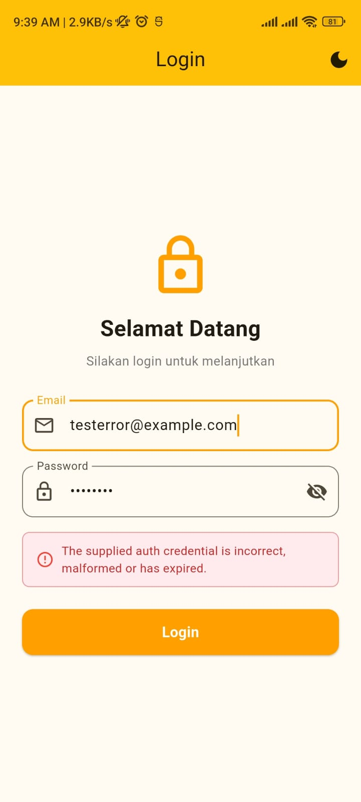

# Latihan 009 - Aplikasi Mobile (Firebase Authentication)

Aplikasi mobile berbasis Flutter yang mengimplementasikan sistem autentikasi pengguna menggunakan **Firebase Authentication (Email & Password)**. Proyek ini dibangun dengan struktur modular yang memisahkan logika pemantau status autentikasi (*auth state wrapper*), antarmuka login (*login screen*), dan dashboard profil pengguna (*user info screen*).

---

## 📱 Tangkapan Layar (Screenshots)

> Simpan file tangkapan layar Anda di dalam folder [`screenshots/`](screenshots/) lalu sesuaikan nama filenya di bawah ini.

| Halaman Login | Dashboard Pengguna | Status Error / Validasi |
| :---: | :---: | :---: |
| <br>*(Taruh screenshot `login_screen.png` di sini)* | <br>*(Taruh screenshot `user_info_screen.png` di sini)* | <br>*(Taruh screenshot `error_state.png` di sini)* |

---

## ✨ Fitur Utama

- **Inisialisasi Firebase Multi-Platform**: Terhubung ke proyek Firebase melalui konfigurasi platform `firebase_options.dart`.
- **Deteksi Sesi Otomatis (`AuthWrapper`)**:
  - Menggunakan `StreamBuilder<User?>` yang mendengarkan `FirebaseAuth.instance.authStateChanges()`.
  - Otomatis mengarahkan ke `UserInfoScreen` jika pengguna telah masuk, atau `LoginScreen` jika sesi belum aktif.
  - Menampilkan indikator loading visual saat status sesi sedang diverifikasi.
- **Halaman Login yang Ergonomis & Responsif**:
  - Header visual minimalis (ikon gembok, judul, dan subtitle).
  - Input email dengan ikon dan hint yang jelas.
  - Input password dengan tombol *toggle visibility* (lihat / sembunyikan password).
  - Penanganan error Firebase Auth (`FirebaseAuthException`) dalam bentuk alert banner yang rapi.
  - Tombol login berukuran proporsional dengan status loading interaktif.
  - Layout anti-overflow keyboard menggunakan `SingleChildScrollView`.
- **Dashboard Info Pengguna & Logout**:
  - Menampilkan foto profil pengguna (`CircleAvatar` dengan fallback ikon akun jika foto kosong).
  - Menampilkan detail informasi akun: **UID**, **Display Name**, **Email**, **Status Verifikasi Email**, dan **Waktu Terakhir Login**.
  - Tombol logout di `AppBar` yang langsung memperbarui state dan mengembalikan pengguna ke halaman login secara otomatis.

---

## 📂 Struktur Proyek

```text
lib/
├── auth/
│   └── auth_wrapper.dart       # StreamBuilder pemantau perubahan sesi autentikasi
├── screens/
│   ├── login_screen.dart       # Form login (Email/Password) & penanganan error
│   └── user_info_screen.dart   # Tampilan profil pengguna & tombol logout
├── firebase_options.dart       # Konfigurasi otomatis Firebase lintas platform
└── main.dart                   # Entry point aplikasi & inisialisasi Firebase
```

---

## 🛠️ Prasyarat & Dependensi

Proyek ini menggunakan dependensi resmi berikut pada `pubspec.yaml`:

- **Flutter SDK**: `>=3.13.4`
- **[firebase_core](https://pub.dev/packages/firebase_core)**: Inisialisasi layanan inti Firebase.
- **[firebase_auth](https://pub.dev/packages/firebase_auth)**: Penyedia layanan otentikasi Firebase (Email & Password).
- **cupertino_icons**: Ikon pendukung iOS style.

---

## 🚀 Panduan Menjalankan Aplikasi

1. **Clone repositori**:
   ```bash
   git clone <url-repository-anda>
   cd latihan_009_aplikasi_mobile
   ```

2. **Unduh seluruh dependensi**:
   ```bash
   flutter pub get
   ```

3. **Pastikan Firebase Console Aktif**:
   - Pastikan provider **Email/Password** sudah diaktifkan di [Firebase Console](https://console.firebase.google.com/) pada menu **Authentication > Sign-in method**.
   - Sudah terdapat akun pengguna yang terdaftar di Firebase Console atau via pendaftaran Firebase.

4. **Jalankan aplikasi**:
   ```bash
   flutter run
   ```
