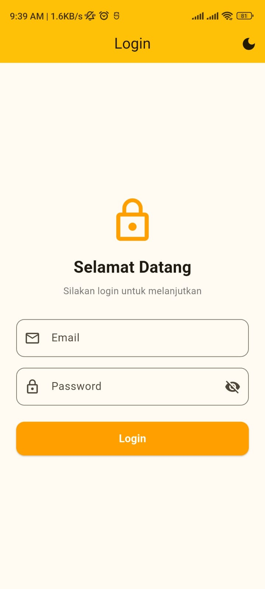
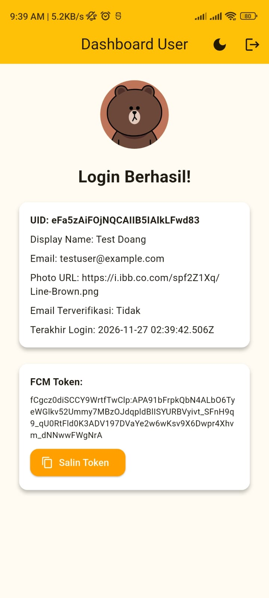
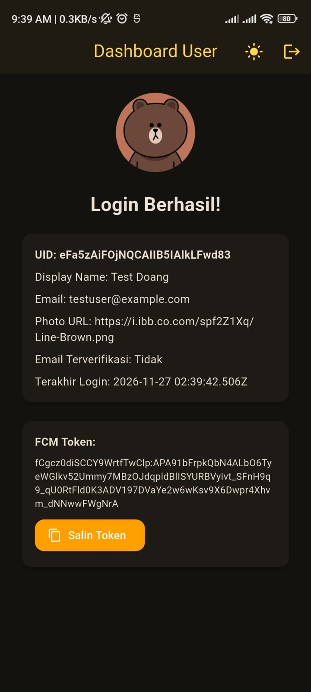
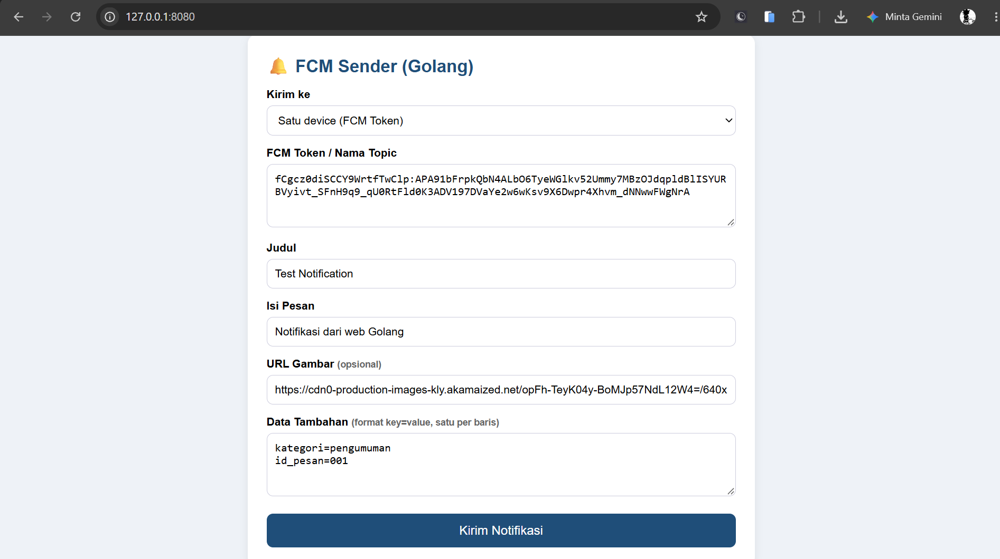
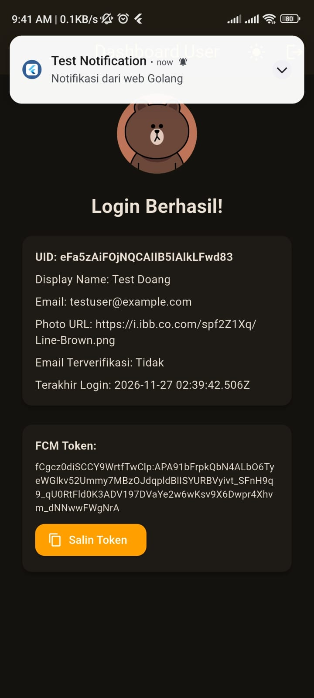
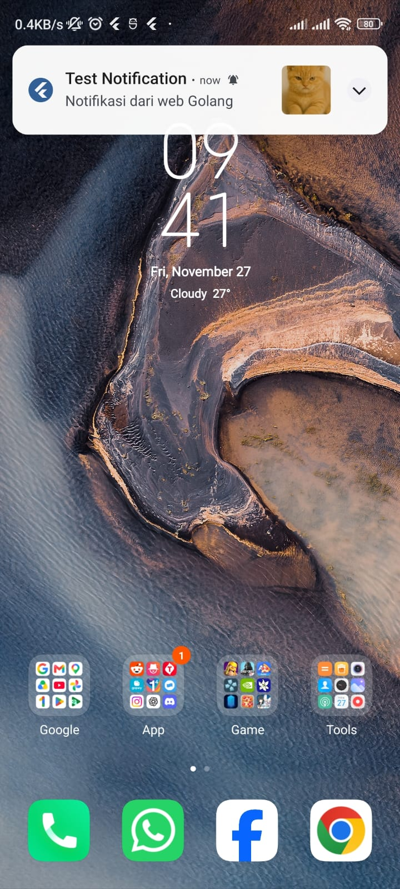
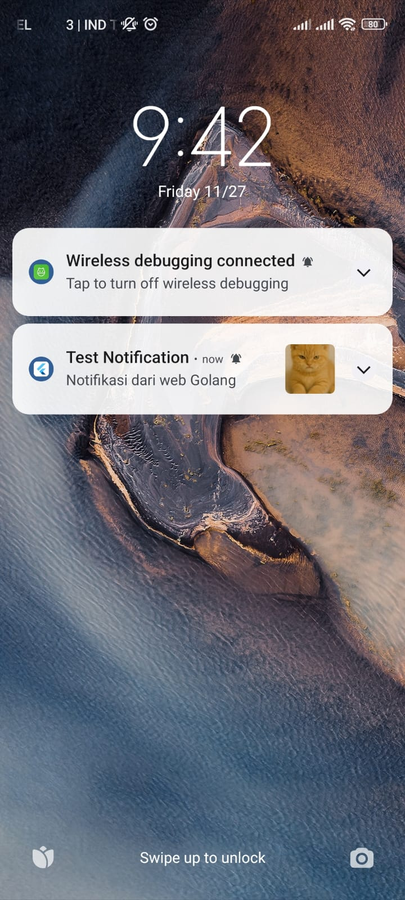
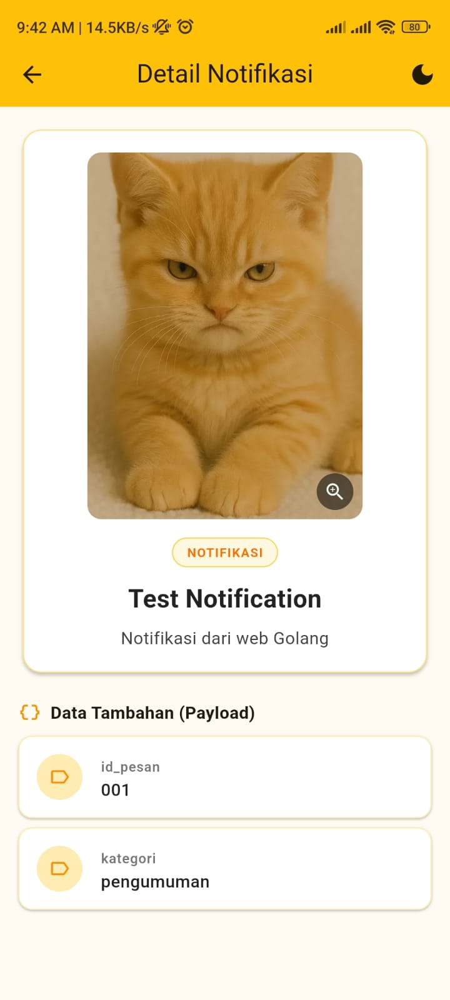

# Latihan 009 - Aplikasi Mobile (Firebase Auth, FCM Push Notification & Amber Day/Night Theme)

Aplikasi mobile berbasis Flutter yang mengimplementasikan autentikasi pengguna menggunakan **Firebase Authentication (Email & Password)**, notifikasi push menggunakan **Firebase Cloud Messaging (FCM)** + **Flutter Local Notifications**, tema global **Amber** dengan dukungan **Mode Siang & Malam (Day & Night)**, serta **Web Pengirim Notifikasi FCM HTTP v1** (Golang, Python, dan PHP) sebagai alternatif Postman.

---

## 🔐 Akun Uji Coba (Test User)

Gunakan akun berikut untuk login dan melakukan pengujian aplikasi:

| Field | Nilai |
| :--- | :--- |
| **Email** | `testuser@example.com` |
| **Password** | `testuser` |

---

## 📱 Tangkapan Layar (Screenshots)

### 1. Autentikasi, Tema & Dashboard
| Login Screen | Dashboard & FCM Token | Night Mode (Amber Dark) | Error State |
| :---: | :---: | :---: | :---: |
|  |  |  |  |

### 2. Pengujian Notifikasi (Web Sender, 3 Skenario & Detail)
| Web Sender FCM (Golang) | Skenario A: Foreground | Skenario B: Background | Skenario C: Terminated |
| :---: | :---: | :---: | :---: |
|  |  |  |  |

| Detail Notifikasi | Zoom Gambar Notifikasi |
| :---: | :---: |
|  |  |

#### Keterangan Screenshot
- [x] `screenshots/login_screen.png` — Tampilan halaman login (tema Amber).
- [x] `screenshots/user_info_screen.png` — Tampilan dashboard info akun dan kartu FCM Token beserta tombol **Salin Token**.
- [x] `screenshots/theme_dark_mode.png` — Tampilan aplikasi saat tombol bulan/matahari diklik ke **Mode Malam (Night Mode)**.
- [x] `screenshots/error_state.png` — Tampilan alert error ketika email/password salah.
- [x] `screenshots/fcm_sender_web.png` — Tampilan web sender Golang (`http://127.0.0.1:8080`) yang menunjukkan `Status: 200` setelah mengirim notifikasi.
- [x] `screenshots/notif_foreground.png` — Tangkapan layar notifikasi pop-up saat aplikasi sedang dibuka (**Skenario A**).
- [x] `screenshots/notif_background.png` — Tangkapan layar notifikasi di status bar saat aplikasi di-minimize (**Skenario B**).
- [x] `screenshots/notif_terminated.png` — Tangkapan layar notifikasi tetap muncul saat aplikasi sudah ditutup dari Recent Apps (**Skenario C**).
- [x] `screenshots/notification_detail_screen.png` — Tampilan halaman **Detail Notifikasi** (gambar utuh tanpa terpotong, badge, judul, isi pesan, dan payload data tambahan).
- [x] `screenshots/notification_image_zoom.png` — Tampilan zoom gambar fullscreen saat gambar pada detail notifikasi diklik.

---

## ✨ Fitur Utama

- **Autentikasi Firebase (`AuthWrapper`)**:
  - Memantau perubahan sesi secara real-time lewat `FirebaseAuth.instance.authStateChanges()`.
  - Otomatis mengarahkan ke `UserInfoScreen` jika login aktif, atau `LoginScreen` jika belum login.
- **Dashboard Info Pengguna & FCM Token (`UserInfoScreen` & `FcmTokenCard`)**:
  - Menampilkan foto profil (`CircleAvatar` dengan fallback ikon profil), **UID**, **Display Name**, **Email**, **Status Verifikasi Email**, dan **Waktu Terakhir Login**.
  - Menampilkan **FCM Token** device lengkap dengan tombol **Salin Token** ke clipboard.
- **Push Notification Lengkap (`NotificationService`)**:
  - Meminta izin notifikasi (termasuk Android 13+).
  - Membuat Android Notification Channel `high_importance_channel`.
  - Otomatis subscribe ke topic `kelas`.
  - Menangani notifikasi pada 3 kondisi: **Foreground** (`flutter_local_notifications`), **Background** (`onMessageOpenedApp`), dan **Terminated** (`getInitialMessage` & `firebaseMessagingBackgroundHandler`).
- **Detail Notifikasi & Zoom Gambar (`NotificationDetailScreen`)**:
  - Menampilkan gambar dari notifikasi dengan `BoxFit.contain` sehingga tidak terpotong di berbagai ukuran/rasio gambar.
  - Gambar dapat diklik untuk masuk ke mode **zoom fullscreen** (`InteractiveViewer` 0.8x–4.0x + double-tap 2.0x).
  - Menampilkan judul, isi pesan, dan daftar seluruh `data payload` tambahan (selain `title`, `body`, `image`).
- **Tema Global Amber & Day/Night Mode (`ThemeController`)**:
  - Menggunakan Material 3 `ColorScheme.fromSeed(seedColor: Colors.amber)`.
  - Tombol toggle **Mode Siang / Mode Malam** tersedia di `AppBar` seluruh halaman (`LoginScreen`, `UserInfoScreen`, dan `NotificationDetailScreen`).
- **Web Sender FCM HTTP v1 (Tanpa Postman)**:
  - Tersedia 3 pilihan backend sender lokal di folder `golang/`, `python/`, dan `php/`.

---

## 📂 Struktur Proyek

```text
├── lib/
│   ├── auth/
│   │   └── auth_wrapper.dart           # StreamBuilder pemantau status autentikasi
│   ├── screens/
│   │   ├── login_screen.dart           # Halaman login Email/Password + tombol tema
│   │   └── user_info_screen.dart       # Dashboard profil user, logout, & FCM token
│   ├── fcm_token_card.dart             # Kartu tampil & salin FCM Token
│   ├── firebase_options.dart           # Konfigurasi Firebase lintas platform
│   ├── main.dart                       # Entry point, tema Amber Day/Night, & init FCM
│   ├── notification_detail_screen.dart # Halaman detail notifikasi & zoom gambar
│   ├── notification_service.dart       # Service FCM foreground, background, terminated
│   └── theme_controller.dart           # Pengelola state Mode Siang & Malam + tombol toggle
├── golang/                             # Web FCM Sender versi Golang (std library, port 8080)
├── python/                             # Web FCM Sender versi Python Flask (port 5000)
├── php/                                # Web FCM Sender versi PHP (port 8000)
└── screenshots/                        # Folder penyimpanan screenshot dokumentasi
```

---

## 🛠️ Prasyarat & Dependensi

Dependensi pada `pubspec.yaml`:
- **Dart/Flutter SDK**: `^3.13.4`
- **`firebase_core`**: `^5.2.0` — Inisialisasi layanan inti Firebase.
- **`firebase_auth`**: `^7.1.0` — Autentikasi Email & Password.
- **`firebase_messaging`**: `^17.1.0` — Penerimaan push notification FCM.
- **`flutter_local_notifications`**: `^23.0.4` — Menampilkan notifikasi pop-up saat aplikasi di foreground.
- **`cupertino_icons`**: `^1.0.8` — Ikon pendukung iOS style.

---

## 🚀 Panduan Menjalankan Aplikasi

1. **Unduh dependensi Flutter**:
   ```bash
   flutter pub get
   ```
2. **Jalankan aplikasi di emulator / HP Android**:
   ```bash
   flutter run
   ```
3. **Login menggunakan akun test**:
   - Email: `testuser@example.com`
   - Password: `testuser`
4. **Pastikan izin notifikasi disetujui** saat dialog izin muncul (Android 13+).

### Menjalankan Web Pengirim Notifikasi (Pengganti Postman)
1. Download private key **Service Account** dari Firebase Console (**Project Settings > Service accounts > Generate new private key**), lalu simpan sebagai `service-account.json` di dalam folder backend yang dipilih (file ini sudah diabaikan di `.gitignore`).
2. Pilih salah satu backend:
   - **Golang** *(disarankan, tanpa install library tambahan)*:
     ```bash
     cd golang
     go run .
     ```
     Buka di browser: `http://127.0.0.1:8080`
   - **Python (Flask)**:
     ```bash
     cd python
     pip install -r requirements.txt
     python app.py
     ```
     Buka di browser: `http://localhost:5000`
   - **PHP**:
     ```bash
     cd php
     php -S localhost:8000
     ```
     Buka di browser: `http://localhost:8000`

---

## 9. Pengujian 3 Skenario

### Persiapan Sebelum Pengujian
1. Jalankan aplikasi di perangkat/emulator Android (`flutter run`) dan pantau **Debug Console** (VS Code / Android Studio) atau `flutter logs`.
2. Login memakai akun uji coba (`testuser@example.com` / `testuser`) hingga masuk ke halaman **Dashboard User**.
3. Di kartu **FCM Token**, klik **Salin Token** (atau gunakan topic `kelas` karena aplikasi otomatis subscribe ke topic `kelas` saat `NotificationService.init()`).
4. Siapkan **Postman** atau **Web Sender Golang** (`http://127.0.0.1:8080`) dengan payload FCM HTTP v1 berikut (mengacu pada langkah 8.4):

```json
{
  "message": {
    "token": "<TEMPEL_FCM_TOKEN_DARI_APLIKASI>",
    "notification": {
      "title": "Halo Mahasiswa",
      "body": "Notifikasi dari FCM",
      "image": "https://picsum.photos/600/300"
    },
    "android": {
      "priority": "high",
      "notification": {
        "channel_id": "high_importance_channel"
      }
    },
    "data": {
      "kategori": "pengumuman",
      "id_pesan": "001",
      "image": "https://picsum.photos/600/300"
    }
  }
}
```
> **Catatan URL Gambar:** Gunakan URL gambar langsung (`.jpg`, `.png`, `.webp`, atau endpoint gambar seperti `https://picsum.photos/600/300`), bukan URL halaman artikel HTML.

---

### Skenario A — Aplikasi FOREGROUND (sedang dibuka)
1. Biarkan aplikasi **tetap terbuka dan aktif di layar** (halaman Dashboard User).
2. Kirim payload 8.4 dari **Postman** atau klik **Kirim Notifikasi** dari **Web Sender Golang**.
3. **Hasil yang diharapkan**:
   - Notifikasi pop-up (*heads-up notification*) muncul di bagian atas layar (ditampilkan oleh `flutter_local_notifications` melalui `_showForegroundNotification()` karena Android tidak menampilkan notifikasi FCM otomatis saat app di foreground).
   - **Debug Console** menampilkan log:
     ```text
     I/flutter: [FCM] Pesan FOREGROUND: Halo Mahasiswa
     ```
4. **Klik notifikasi** → aplikasi langsung membuka halaman **Detail Notifikasi** (`NotificationDetailScreen`) yang menampilkan gambar (bisa diklik untuk zoom), `title` (`Halo Mahasiswa`), `body`, serta daftar data tambahan (`kategori: pengumuman`, `id_pesan: 001`).

---

### Skenario B — Aplikasi BACKGROUND (di-minimize)
1. Tekan tombol **Home** pada HP/emulator agar aplikasi berpindah ke background (**jangan ditutup / swipe dari Recent Apps**).
2. Kirim ulang payload dari **Postman** atau **Web Sender Golang**.
3. **Hasil yang diharapkan**:
   - Notifikasi muncul di **status bar / notification tray** (ditampilkan otomatis oleh sistem Android menggunakan channel `high_importance_channel`).
   - *(Jika handler background dipicu, console juga mencatat `[FCM] Pesan BACKGROUND: ...`)*.
4. **Klik notifikasi** pada status bar → aplikasi kembali naik ke depan (*resumed*) dan otomatis membuka halaman **Detail Notifikasi**. **Debug Console** menampilkan:
   ```text
   I/flutter: [FCM] Dibuka dari BACKGROUND
   ```

---

### Skenario C — Aplikasi MATI (terminated)
1. Buka **Recent Apps**, lalu **swipe / geser aplikasi** untuk menutupnya sepenuhnya (status *terminated*).
   > **Catatan penting Android:** Jangan gunakan **Force Stop** dari menu *App Info / Settings*, karena *Force Stop* di Android akan memblokir seluruh background service & FCM sampai user membuka aplikasi lagi secara manual. Cukup swipe dari Recent Apps.
2. Kirim ulang payload dari **Postman** atau **Web Sender Golang**.
3. **Hasil yang diharapkan**:
   - Notifikasi **tetap muncul** di status bar / notification tray walaupun aplikasi dalam keadaan mati (`firebaseMessagingBackgroundHandler` yang diberi anotasi `@pragma('vm:entry-point')` berjalan di isolate terpisah dan sistem Android tetap menampilkan blok `notification`).
4. **Klik notifikasi** → aplikasi diluncurkan ulang dari awal dan setelah inisialisasi langsung membuka halaman **Detail Notifikasi** lewat `FirebaseMessaging.instance.getInitialMessage()`. **Debug Console** menampilkan:
   ```text
   I/flutter: [FCM] Dibuka dari kondisi MATI (terminated)
   ```

---

### Ringkasan Hasil Pengujian

| Skenario | Kondisi Aplikasi | Mekanisme Penampil Notif | Log Console Saat Diterima / Diklik | Hasil Klik Notifikasi |
| :--- | :--- | :--- | :--- | :--- |
| **A** | Foreground (dibuka) | `flutter_local_notifications` (`onMessage`) | `[FCM] Pesan FOREGROUND: Halo Mahasiswa` | Membuka `NotificationDetailScreen` |
| **B** | Background (minimize) | Sistem Android (`notification` + `channel_id`) | `[FCM] Dibuka dari BACKGROUND` | Kembali ke app & buka `NotificationDetailScreen` |
| **C** | Terminated (mati) | Sistem Android + `@pragma('vm:entry-point')` | `[FCM] Dibuka dari kondisi MATI (terminated)` | App start & langsung buka `NotificationDetailScreen` |

---

## 📦 Build & Release APK

### Cara Build Release APK
Jalankan perintah berikut di root project:
```bash
flutter build apk --release
```

### Lokasi & Detail Output APK
- **File APK Release**: `build/app/outputs/flutter-apk/app-release.apk` (49.4 MB)
- **Application ID / Package**: `com.example.latihan_009_aplikasi_mobile` (dikonfigurasi di `android/app/build.gradle.kts`)
- **Signing Config**: Menggunakan debug signing key default agar APK release bisa langsung diinstall untuk pengujian (`signingConfig = signingConfigs.getByName("debug")`).
- **Instalasi ke HP Android**:
  1. Salin `build/app/outputs/flutter-apk/app-release.apk` ke HP Android (atau install lewat ADB: `adb install build/app/outputs/flutter-apk/app-release.apk`).
  2. Aktifkan izin **Install unknown apps** jika diminta, lalu install dan jalankan aplikasi.
  > **Catatan Git:** Folder `/build` di-ignore oleh `.gitignore`, jadi untuk membagikan file `app-release.apk` ke orang lain / dosen, upload file tersebut ke menu **GitHub Releases** pada repository ini (atau Google Drive).
